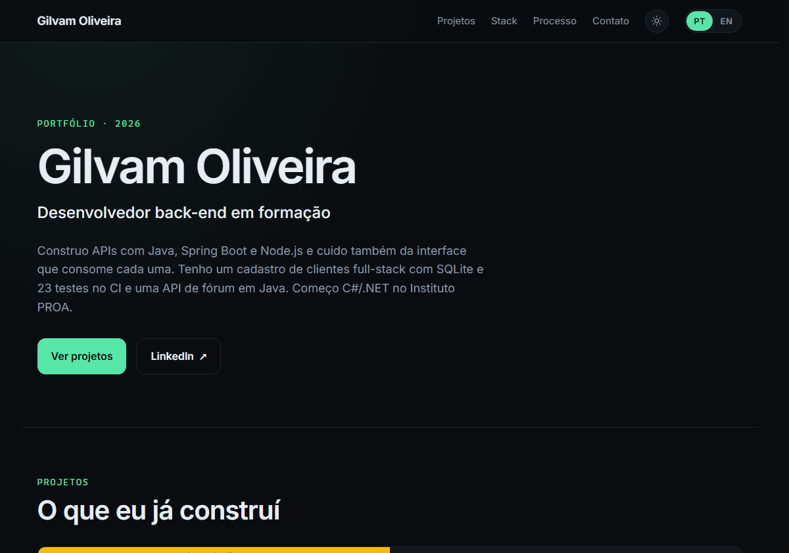

# Portfólio — Gilvam Oliveira

Portfólio pessoal de Gilvam Oliveira, desenvolvedor front-end em formação. Uma página única, em português e inglês, com três projetos, stack, processo de trabalho e contato.

[](https://gilvamoliveira.vercel.app)

## Sobre o projeto

Site de página única construído com React e Vite para apresentar meus projetos, as tecnologias que uso e a forma como trabalho. A interface prioriza leitura, contraste e navegação simples, sem router e sem bibliotecas de componentes.

O conteúdo é separado da apresentação: os dados estruturais dos projetos ficam em `src/data/projects.js`, enquanto todos os textos PT-BR e EN-US ficam em `src/i18n/`.

## Destaques

- **Bilíngue (PT-BR / EN-US):** troca de idioma em tempo real, com preferência salva no navegador.
- **Responsivo:** layout adaptado para celular, tablet e desktop.
- **Acessível:** skip link, foco visível, contraste conferido, textos alternativos e suporte a `prefers-reduced-motion`.
- **Sem router:** navegação por âncoras entre as seções.
- **CSS próprio:** design tokens para cores, espaçamento e tipografia, sem framework de UI.
- **Conteúdo centralizado:** textos em arquivos de i18n e dados dos projetos em um único módulo.

## Stack

| Camada | Tecnologias |
| --- | --- |
| Interface | React 19 |
| Build | Vite 8 |
| Estilos | CSS puro com design tokens |
| Tipografia | Inter Variable (`@fontsource-variable/inter`) |
| Idioma | Context API + `localStorage` |
| Deploy | Vercel |

## Demo

- **Site:** [gilvamoliveira.vercel.app](https://gilvamoliveira.vercel.app)
- **Repositório:** [github.com/GilvamOliveira/portfolio](https://github.com/GilvamOliveira/portfolio)

## Como rodar

Requisitos: **Node.js 22.12 ou superior**.

```bash
npm install
npm run dev      # servidor local em http://localhost:5173
npm run build    # gera dist/
npm run preview  # serve dist/ em http://localhost:4173
```

## Estrutura

```text
.
├── docs/
│   └── preview.png        prévia usada no README
├── public/
│   ├── projects/          capturas dos três projetos
│   ├── og.png             imagem de compartilhamento (1200x630)
│   └── favicon.svg
├── src/
│   ├── App.jsx            composição das seções
│   ├── main.jsx           entrada da aplicação
│   ├── styles.css         tokens, layout e responsividade
│   ├── components/        Header, Hero, Section, Projects, ProjectCard,
│   │                      Stack, Process, Contact, Footer, LocaleToggle
│   ├── data/
│   │   └── projects.js    dados estruturais dos projetos
│   └── i18n/
│       ├── pt.js          textos em português
│       ├── en.js          textos em inglês
│       └── LocaleContext.jsx
├── index.html
├── package.json
└── vite.config.js
```

## Onde editar

- **Textos:** `src/i18n/pt.js` e `src/i18n/en.js`. As duas árvores têm a mesma forma; ao adicionar uma chave, adicione nas duas.
- **Projetos:** `src/data/projects.js` guarda apenas o que não é traduzível (`id`, `number`, `stack`, `demo`, `repo`, `image`, `width`, `height`, `featured`). Título, resumo e “meu papel” ficam nos arquivos de i18n, indexados pelo `id`.
- **Cores, espaçamento e tipografia:** tokens no topo de `src/styles.css`. Grid de 8px e paleta escura (`--bg #0a0c0f`, `--accent #58e6a8`).
- **Imagens:** proporção 4:3, recortadas com `object-fit: cover` e `object-position: top center`. Substitua mantendo a proporção para não cortar títulos.

## Idioma

O `LocaleContext` lê a preferência em `localStorage["portfolio-locale"]`, atualiza `document.documentElement.lang` e `document.title` e usa `pt-BR` como padrão. O seletor PT/EN usa `aria-pressed` e não recarrega a página.

## Acessibilidade

- Skip link para o conteúdo principal.
- Foco visível (`:focus-visible`) em todos os elementos interativos.
- Contraste conferido na paleta escura e imagens com `alt` descritivo.
- `prefers-reduced-motion` desliga animações e rolagem suave.

## Deploy

O site é publicado na Vercel a partir do repositório `GilvamOliveira/portfolio`.

- **Framework:** Vite
- **Build command:** `npm run build`
- **Output directory:** `dist`
- **Node.js:** 22.12+ (definido em `package.json`)

O repositório está conectado à Vercel: cada push na branch `main` gera um novo deploy de produção.

Para publicar manualmente:

```bash
npm install -g vercel
vercel --prod
```

O nome do projeto na Vercel deve ser `gilvamoliveira`, que define a URL `https://gilvamoliveira.vercel.app`.

### Domínio próprio

O domínio `gilvam.is-a.dev` aponta para `cname.vercel-dns.com`. O registro é feito por um PR manual em `is-a-dev/register`, com o arquivo `domains/gilvam.json` escrito à mão, conforme as regras do projeto.

## Créditos

- Fonte [Inter](https://rsms.me/inter/), empacotada via `@fontsource-variable/inter`.
- Capturas dos projetos publicados em `public/projects/`.

## Uso

O código está disponível para consulta e referência. Os textos, imagens e a identidade visual são pessoais e não devem ser reutilizados como portfólio de outra pessoa.
